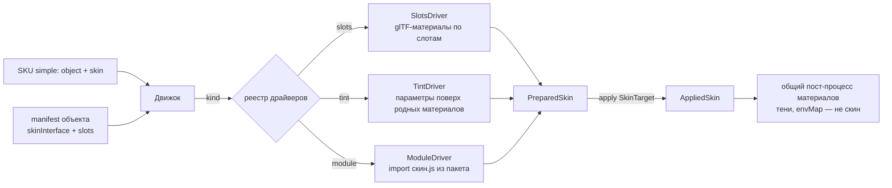

# 02 · Скин — единый загрузчик (проект, на обсуждение)

_Статус: **issue #1 сделан, на ревью** (8 ноя 2026). Итог — §8. Разделы 1–5 — исходный проект и вопросы; что из них принято, а что нет — тоже в §8. Закрывает [ISSUES I-01 / #1](../../ISSUES.md)._

**Цель.** Плеер не знает заранее, какие скины бывают у объекта. Скин приезжает вместе с пакетом объекта.
Внутри скина могут быть данные (JSON), код или их сочетание. Движок предоставляет точку подключения и общий жизненный цикл, а реализация остаётся внутри скина.

---

## 1. Что есть в проекте сейчас (инвентаризация)

| Объект | Как задан «цвет/материал» | Где живёт логика | Текстуры |
|---|---|---|---|
| **bottle** (плеер, `objects/bottle/v01`) | Внешний скин `skin.json`: подмножество glTF-материалов, привязанных к слотам `extras.materialSlotId`; профили `low`/`final` | `skinLoader.ts` — сверка с глобальным `bottleSkins.json`, **ровно 7 слотов** | отдельно, имя = sha256, общие для всех скинов объекта |
| **bottle** (старая студия) | Материалы зашиты в GLB; `BottleCoating` перекрашивается из `specification.colors` (hex/metalness/roughness) | `sourceModel.configureSourceModel` | внутри GLB |
| **endo** | Материалы зашиты в GLB; перекраска **по префиксу имени**: `EndoStrap*` ← `hex`, `EndoFrame*` ← `frame` | `sourceModel.configureSourceModel` | внутри GLB (normal/roughness ткани) |
| **pillow** | Один цвет, материалы в GLB; правки на объекте: `shadowSide`, анизотропия, отключение тени у швов по regex | `PillowScene.tsx` | внутри GLB |
| **mug / notebook / pen** | Без вариантов; только материал печати (`LOGO_PRINT`, `DIGITAL_PRINT`, `LASER_ENGRAVING`) | `model.ts printableMaterial`, `Scene.tsx` | внутри GLB |

Поверх любого материала движок сейчас применяет и общие правки, которые к самому скину не относятся:
`bottleSoftShadows()` — патч шейдера под мягкие тени; `envMapIntensity = 1`; `anisotropy = 8` (только для бутылки); переворот `normalScale.y` при производных тангентах.

**Вывод.** Сейчас в проекте три разных механизма. **Слот-скин** (бутылка) — уже почти правильная модель: геометрия и внешний вид разделены, связь идёт через слоты. **Перекраска по имени** (endo, старая бутылка) по сути тоже скин, только параметрический и поверх «родных» материалов GLB. **Материал печати** — это нанесение логотипа, а не скин; это отдельный слой, см. I-07.

## 2. Ключевая идея

Разделяем три вещи:

1. **Поверхность скина** объявляет **объект**: какие у него слоты и под каким именем-версией интерфейса (`skinInterface`). Это аналог интерфейса в ООП.
2. **Скин** объявляет, какой интерфейс он реализует (`implements`), и как именно — через `kind`.
3. **Драйвер** — код, который умеет выполнить скин данного `kind`.
   - Драйверы для данных (`slots`, `tint`) лежат в движке. Они generic, их немного, объектов они не знают.
   - Драйвер `module` загружает **программный скин** из пакета объекта. Дальше скин сам решает, как себя реализовать: может сгенерировать текстуры, собрать материал, поправить шейдер в рамках своих слотов.

Совместимость проверяется так: `skin.implements === object.skinInterface.id`. Глобальный реестр скинов и константа бутылки больше не нужны.



## 3. Интерфейсы (TypeScript)

```ts
/** ── Объявляет ОБЪЕКТ (manifest.render.skin) ───────────────────────────── */
interface ObjectSkinSurface {
  /** имя+версия интерфейса скина: 'bottle-materials-v01', 'endo-materials-v01' */
  interface: string
  /** слоты, доступные скину; остальное скину недоступно */
  slots: Array<{ id: string; label?: Record<string, string> }>
  /** как найти слот в GLB: extras.materialSlotId (готово к скинам) или по имени материала (миграция) */
  binding: { by: 'extras' } | { by: 'materialName'; map: Record<string /*glTF material*/, string /*slot*/> }
  /** что лежит в GLB на месте слотов: полноценные материалы или заглушки */
  baseMaterials: 'embedded' | 'placeholder'
  defaultSkin: string                 // 'endo-black@v01'
}

/** ── Объявляет СКИН (skins/<id>/<rev>/skin.json) ────────────────────────── */
interface SkinDescriptor {
  schemaVersion: 2
  id: string; revision: string
  implements: string                  // === ObjectSkinSurface.interface
  kind: 'slots' | 'tint' | 'module'   // какой драйвер исполняет
  /** kind='module': точка входа кода внутри пакета, с sha (код — тоже часть, проверяем целостность) */
  entry?: { file: string; sha256: string; bytes: number }
  /** данные для драйвера / параметры для модуля; движок их НЕ читает */
  data?: unknown
}

/** ── Что движок даёт скину (единственная «поверхность» объекта) ──────────── */
interface SkinTarget {
  object: { id: string; revision: string; interface: string }
  quality: 'low' | 'final'
  slots: ReadonlyMap<string, SlotHandle>
  /** движок: загрузка частей пакета с проверкой sha, кэш текстур по sha, общий three */
  resources: SkinResources
}
interface SlotHandle {
  id: string
  meshes: readonly import('three').Mesh[]        // только чтение: геометрию скин не трогает
  base: import('three').Material | null          // «родной» материал из GLB (для tint/module)
  set(material: import('three').Material): void  // единственный способ изменить вид
}
interface SkinResources {
  three: typeof import('three')                   // единый экземпляр three движка
  part(file: string, signal: AbortSignal): Promise<ArrayBuffer>      // только файлы из manifest, sha проверяется
  texture(file: string, opts: TextureOptions, signal: AbortSignal): Promise<Lease<import('three').Texture>>
}

/** ── Драйвер (код движка или модуль скина) ──────────────────────────────── */
interface SkinDriver {
  kind: string
  prepare(desc: SkinDescriptor, res: SkinResources, quality: 'low' | 'final', signal: AbortSignal): Promise<PreparedSkin>
}
interface PreparedSkin {
  /** применить к живой модели; повторный apply другого скина того же интерфейса = смена без перезагрузки геометрии */
  apply(target: SkinTarget): AppliedSkin
  dispose(): void
}
interface AppliedSkin {
  dispose(): void          // вернуть слоты в исходное состояние, освободить ресурсы
}

/** ── Программный скин: файл из пакета, export default ──────────────────── */
interface SkinModule {
  apiVersion: 1            // версия API движка для скинов; движок отклоняет несовместимую
  prepare(data: unknown, res: SkinResources, quality: 'low' | 'final', signal: AbortSignal): Promise<PreparedSkin>
}
```

**Как это ложится на существующие объекты**

| Объект | kind | Что в `data` |
|---|---|---|
| bottle | `slots` | текущий `skin.json` почти без изменений: `materials[]` + `profiles` |
| endo | `tint` (на старте) → `slots` (после разбора GLB) | `{ "strap": {"color":"#24272c"}, "frame": {"color":"#343940"} }` поверх `baseMaterials: embedded` |
| pillow / pen / mug / notebook | `tint` или единственный «родной» скин | один скин `*-default@v01` с пустым `data` — правило «у simple всегда есть скин» не ломается |
| будущее (процедурная ткань, Pantone, градиент) | `module` | параметры модуля |

## 4. Что меняется в движке (когда начнём реализацию)

1. `compatible()` / `normaliseSkin()` / `SKIN_COMPATIBILITY` / проверка «ровно 7» удаляются. Вместо них сверяется `implements` с интерфейсом объекта, а слоты проверяются по поверхности объекта: каждый слот скина есть у объекта, обязательные слоты закрыты.
2. `bindSkin()` превращается в построение `SkinTarget` из GLB (слоты по `binding`) и вызов `apply`. Код перекраски по префиксам имён уходит из `sourceModel.ts`.
3. Общий **пост-процесс материалов** — отдельный шаг движка после `apply`: тени (`bottleSoftShadows` → нейтральное имя), `envMapIntensity`, тангенты. Скин об этом не знает. Объектные подсказки (анизотропия, `shadowSide`) — в `manifest.render`, а не в коде.
4. Нынешний `skinLoader.ts` целиком становится `SlotsDriver` — логика текстур, кэша и sha переиспользуется.

Объём работ: шаг 1 небольшой и разблокирует endo через `tint`. Шаги 2–4 — средний рефакторинг, затрагивает студию (`App`, `BottleApiPage`), нужно ревью.

## 5. Вопросы к владельцу

1. **Код из пакета объекта (`kind: module`).** Это исполнение кода, пришедшего из хранилища, — и в браузере клиента, и в PNG-рендерере. Достаточно ли проверки sha по манифесту плюс доверенного источника пакетов? Или нужна изоляция (worker / iframe) или подпись пакетов? Предлагаю на старте доверять пакетам и проверять sha, а `module` сделать последним шагом.
2. **Границы скина.** Что скин может менять: только материалы своих слотов? Видимость частей (например, «вариант без крышки»)? Геометрию — нет? Предлагаю ограничиться материалами слотов. Видимость — только у частей, которые объект явно объявил управляемыми скином.
3. **Привязка к слотам.** Можно ли на переходный период находить слоты по имени материала через карту в манифесте, без перепаковки GLB? Или сразу требовать `extras.materialSlotId`, то есть prepare-шаг для каждого объекта?
4. **Где живут скины.** Только внутри ревизии объекта (`objects/<id>/<rev>/skins/`), как сейчас? Или бывают общие скины на несколько объектов (общая палитра бренда)? Если общие — `implements` позволяет такое без изменения формата.
5. **Параметры от SKU.** SKU передаёт только `skin: id@rev`, или ещё и параметры (например, цвет Pantone под клиента — один скин-модуль на много цветов)? Предлагаю пока только ключ; параметры — отдельное решение.
6. **Версия API скинов** (`apiVersion`) и версия `three`. Программный скин обязан использовать `three` движка (`res.three`), а не свой импорт. Согласны ли вы держать API скинов как публичный контракт с версией?
7. **Fingerprint PNG.** В кэш-ключ рендера входит sha дескриптора скина. Для `module` — ещё sha кода и всех прочитанных частей. Согласны?

---

## 6. Пул обработчиков материалов (реализовано, `app/src/player/materials/materialPipeline.ts`)

**Решение владельца (7 ноя 2026).** Всё, что дорабатывает материал поверх базового скина, заходит в материал через **один пул** с фиксированной очерёдностью: улучшения скина, переходы LOD, брендинг, тени и прочие общие правки.

Почему пул: у материала three.js один крючок на шейдер (`onBeforeCompile`) и один ключ программы (`customProgramCacheKey`). Раньше каждый патч оборачивал предыдущий сам, порядок зависел от того, кто позвал первым. Теперь на материале один диспетчер, он вызывает процессоры по правилу:

**стадия → `order` внутри стадии → момент подключения.**

| # | Стадия | Кто | Сейчас |
|---|---|---|---|
| 1 | `skin` | улучшения скина (код из пакета скина) | контракт готов (§7), у бутылки улучшений нет |
| 2 | `lod` | переход low → final | в плеере пока не подключён (кандидат в «гнездо + пакет», как тень) |
| 3 | `branding` | нанесение логотипа/декора | зарезервировано (I-07) |
| 4 | `lighting` | тени — последними | процессоры пакета тени `shadow.<id>.*` ([`shadow.md`](shadow.md)) |

Новая стадия = изменение контракта (ревью).

```ts
interface MaterialProcessor {
  id: string              // уникален на материале; повтор с тем же id — замена, не дубль
  stage: MaterialStage    // 'skin' | 'lod' | 'branding' | 'lighting'
  order?: number          // порядок внутри стадии, по умолчанию 0
  programKey(): string    // меняется, если меняется текст шейдера из patch()
  patch?(shader, renderer, material): void        // правка шейдера до компиляции
  onFrame?(frame: { camera; size }, material): void // на кадр: только uniforms/параметры
}
attachProcessor(material, processor): { detach() }  // единственный путь в шейдер материала
```

Правила:
- Ключ программы материала = ключи процессоров по порядку через `+`. Свой `onBeforeCompile` материала (если был до пула) исполняется первым.
- Состояние пула хранится вне `material.userData`: `Material.copy()` при смене скина его не стирает. `clone()` даёт материал без процессоров.
- `onFrame` получает только камеру и размер кадра — без времени и случайности, чтобы PNG был повторяемым. Кадровый шаг — компонент `player/components/MaterialFrames.tsx`.
- Пул — только для нового плеера (`app/src/player/`). Старая студия и примеры (`example1.html`, `bottle.html`, PNG-воркер) его не используют и не меняются (решение владельца, 8 ноя 2026).

## 7. Улучшение скина (реализовано, `app/src/player/materials/skinEnhancement.ts`)

Базовый скин есть **всегда** (материалы по слотам, glTF). Улучшение — необязательный код из пакета скина, работает поверх базы и заходит в плеер **только через пул**, стадия `skin`. Скина «только из кода» не бывает.

В `skin.json`:
```json
"enhancement": { "file": "skins/<id>/<rev>/enhancement.js", "sha256": "…", "bytes": 1234, "params": { … } }
```
Модуль (`export default`):
```ts
{ apiVersion: 1,
  prepare({ skin, params, quality, three, signal }): Promise<{
    attach(target: { slots: Map<slot, Material[]>; use(slot, processor) }): { dispose?() } | void
    dispose?(): void
  }> }
```
- Код проверяется по sha256 и размеру (≤ 512 КБ), грузится как модуль; `apiVersion` должен совпасть с движком.
- `three` модуль получает от движка, свой импорт three запрещён (одна версия на приложение).
- `use(slot, …)` — только слоты базового скина; стадию задаёт движок, id становится `skin.<id>`. При смене скина движок снимает все процессоры сам и заново копирует базовый скин.
- Можно: параметры и шейдер материалов своих слотов. Нельзя: геометрия, сцена, свет, камера, другие объекты.
- **Ошибки — строго** (решение владельца): сбой загрузки, `prepare` или `attach` = ошибка всего скина. В коде стоят `TODO(I-01, откат улучшения)` в `skinLoader.ts` — места, где можно перейти на откат к базовому скину без улучшения.

Проверено: юнит-тесты `scripts/material-pipeline.test.mjs` (`npm run test:player`); в браузере — тестовый скин с полосами из кода на бутылке, живая смена black → demo → blue без ошибок (тестовый скин в репозиторий не добавлялся).

## 8. Итог issue #1 (8 ноя 2026)

**Скин больше не зашит под бутылку.** В новом плеере нет глобального реестра скинов (`bottleSkins.json`), константы `SKIN_COMPATIBILITY` и проверки «ровно 7 слотов». Что объект принимает как скин, объявляет **сам объект**:

```json
"render": {
  "skin": {
    "compatibility": { "modelId": "bottle", "uvLayout": "bottle-uv-v01", "materialBindings": "bottle-materials-v01" },
    "slots": ["body.plastic", "body.coating", "steel.brushed", "steel.handle", "lid.bamboo", "lid.seal", "decoration"],
    "default": "bottle-black@v01",
    "dir": "skins"
  }
}
```

Правила (`app/src/player/materials/skinContract.ts`):
- скин подходит объекту, если его `compatibility` **совпадает целиком** с `render.skin.compatibility` (ключи — любые, их выбирает объект);
- слоты базового скина — **ровно** `render.skin.slots`: лишний слот, пропущенный слот, дубль — ошибка;
- скин должен лежать в пакете объекта (`<dir>/<id>/<rev>/skin.json`) и быть записан в `manifest.parts.skins` с sha256;
- если GLB сам объявляет совместимость (extras сцены), она обязана совпасть с объектом; каждый слот материала в GLB должен быть объявлен в `render.skin.slots`;
- смена скина на скин с другой поверхностью — ошибка.

Контракты данных: `app/contracts/skin-surface.schema.json` (`render.skin`), `skin.schema.json` (`skin.json`, в файлах — `"$schema"`), типы `app/contracts/skin.ts`. Тесты: `scripts/skin-contract.test.mjs` (объект «не бутылка», 2 слота), `scripts/contracts.test.mjs` (все реальные скины всех объектов против их объекта и схемы).

Проверено в браузере: 9 цветов бутылки; скин, которого нет в старом реестре, с улучшением из кода — показывается; скин с чужой совместимостью — строгая ошибка «not compatible with this object».

**Что принято из §2–5 и что нет:**

| Пункт проекта | Решение |
|---|---|
| Скин = база (данные) + улучшение (код) | **принято** (вместо трёх «драйверов» `slots`/`tint`/`module`): база — всегда слоты glTF, улучшение — код поверх через пул (§6–7) |
| `tint` — перекраска «родных» материалов GLB по имени (Endo) | **не делали.** Endo при миграции получает слот-скины (I-04); привязка слотов по имени материала (`binding: materialName`) — открыт |
| Код из пакета: доверие + sha | **принято**: проверка размера и sha256 до исполнения, `apiVersion` |
| Границы улучшения | **принято**: только материалы своих слотов; геометрия/сцена/свет — нельзя |
| Где живут скины | **в ревизии объекта** (`objects/<id>/<rev>/<dir>/`); общие скины на несколько объектов — не делали (формат позволит: та же `compatibility`) |
| Параметры от SKU | **только ключ скина**; параметры — отдельное решение |
| Fingerprint PNG (sha скина и кода) | **открыт** — решаем вместе с рендер-галереей (Фаза 3) |
| Общий пост-процесс материалов | **принято как пул** (§6); тени вынесены в пакеты ([`shadow.md`](shadow.md)) |

Старая студия и примеры по-прежнему работают со своим реестром (`app/shared/skinContract.mjs`, `bottleSkins.json`) — не трогаем.
