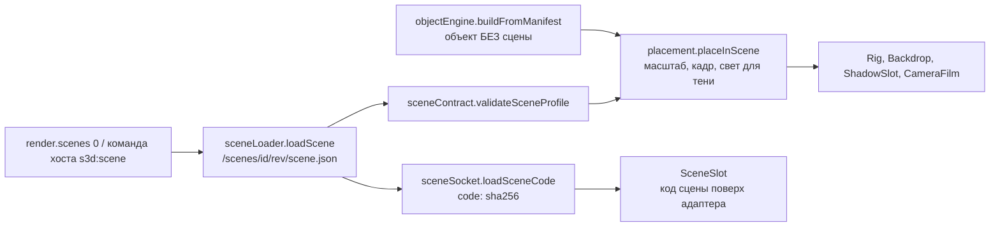
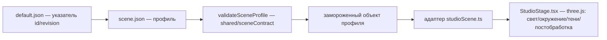

# Слой «Сцена» — свет, окружение, тени (черновик)

## Сцена в новом плеере — отдельная сущность (#4, 8 ноя 2026)

_Решения владельца по [#4](https://github.com/nicsosin-progovori/s-3dlabs-demo/issues/4). Касается только нового плеера
(`app/src/player/`). Старая студия ниже по странице не меняется и остаётся эталоном для визуального сравнения._

**Где лежит.** `scenes/<id>/<rev>/scene.json` — отдельно от объектов, как `shadows/`. Сервер отдаёт по `/scenes/`
(`SCENES_DIR`, по умолчанию `../scenes`). Сейчас: `source-studio@v01`, `source-studio@v02` (перенесены из пакета бутылки).
Объект может пользоваться общей сценой или своей.

**Кто выбирает.** Главный — **объект**. Он независимо выбирает сцену, скин и тень:
```json
"render": {
  "units": "metres",
  "scale": 1,
  "scenes": ["source-studio@v02"],
  "shadow": { "use": "soft-pcss@v01", "params": { … } }
}
```
- `scenes` — массив `<id>@<rev>`, порядок = приоритет («где объекту лучше»). Плеер берёт **первую**.
  Подбор лучшей сцены для 1+ объектов — позже, по этому же массиву.
- Хост может **сменить** сцену у уже показанного объекта (публичная команда `s3d:scene`, переключатель в баре).
  При загрузке объекта **ведёт объект**: прежний выбор хоста не учитывается. Плеер сообщает текущую сцену
  (`#root[data-scene]` + событие `s3d:scene-changed`). Контракт — `player/engine/playerContract.ts`.

**Масштаб.** Сцена **не перестраивается** под объект — сцена масштабирует объект:
```
масштаб объекта в сцене = render.units → метры × render.scale  (объект)
                        × coordinates.worldScale               (сцена: единиц на метр)
```
Объект «не совсем правильного размера» исправляется своей поправкой `render.scale`, сцену не трогаем.
Сейчас обе сцены в единицах ×12 (`worldScale: 12`), бутылка — метры, поправка 1 → как раньше.
Сцену «честно 1:1» можно сделать новой ревизией (свет, софтбоксы, лимиты камеры — в метрах); объекты менять не придётся.

**Сцена и тень.** Тень требует от сцены свет — `shadow.json → needsFromScene`. Плеер проверяет это при загрузке объекта
и **при каждой смене сцены**; не хватает — ошибка. Обратное направление (что сцена разрешает тени и скину) и запасные
варианты — `ISSUES.md` I-10.

**Ошибки — строгие.** Нет файла, битый JSON, вне контракта, чужая identity, тень не подходит — плеер в `error`
(и при загрузке, и при смене сцены хостом).

**Как устроено в плеере.**

- Контракт: `app/contracts/scene.schema.json`, `scene-declaration.schema.json`, типы `scene.ts`; проверка — `player/scenes/sceneContract.ts`
  (те же правила, что `shared/sceneContract.mjs`, кроме: `worldScale` — любое > 0, разрешены `$schema` и `label`). Плеер от `shared/sceneContract.mjs` отвязан.
- Смена сцены не перезагружает объект: пересчитываются масштаб, кадр камеры, свет; окружение для отражений и тень вставляются заново.
- Плеер читает из сцены: `exposure`, `background`, `ambient`, `hemisphere`, `key`, `fill`, `environment`, `shadow.radius`, `shadow.lightMapSize`.
  Остальное (`shadow.*` вида тени, `shadowMap`, `ao`, `revealMs`, `shadowType`) — наследие студии, проверяется, но не используется (I-10).

**Код сцены — слот (заложено 9 ноя 2026).** Сцена может привезти свой код: `scene.json → code`:
```json
"code": { "apiVersion": 1, "entry": { "file": "scene.js", "sha256": "…", "bytes": 1234 }, "params": { … } }
```
- Код вставляется в **слот сцены** (`components/SceneSlot.tsx`) **поверх** встроенного адаптера (Rig, Backdrop):
  адаптер рисует то, что сказано данными; код — то, что данными не выразить (AO, циклорама, свой тон-маппинг, сложный свет).
- Модуль: `export default { apiVersion: 1, create(ctx) → { update?, render?, resize?, dispose } }`. `ctx` — `three`, `renderer`,
  three-сцена кадра, проверенный профиль, `params`, размер. Интерфейс — `player/sockets/sceneSocket.ts`.
- `render(frame)` есть → **код рисует кадр сам** (постобработка), плеер не рисует. Нет → плеер рисует как обычно.
- Сцена **не получает объект** (она продукт-агностична). Доступ к материалам объекта — вместе с требованиями сцены (I-10).
- Смена сцены = `dispose()` старого кода, `create()` нового. Всё, что код добавил, он убирает в `dispose()`.
- Код проверяется по размеру и sha256 до исполнения; любая ошибка — ошибка показа.
- Первое применение — вид старой студии (ISSUES.md I-12).

**Где правила.** Выбор сцены — `player/engine/scenePolicy.ts`; расстановка объекта в сцене — `player/engine/placement.ts`.
Тесты смены сцены — `app/scripts/scene-switch.test.mjs` (`npm run test:player`).

**Открыто.** Единица мира — метр, сцена 1:1 (I-11, на ревью). Камеры и лимиты орбиты при смене сцены (I-03, отложено): кадр пересчитывается, но near/far и лимиты орбиты —
в единицах сцены, «чья камера» не решено. Параметры `soft-pcss` в мировых единицах (`scale`, `position`) верны только для `worldScale: 12` (I-10).

---

_Ниже — разбор слоя в старой студии (до #4)._

_Моя первичная версия для обсуждения. Источники: `docs/SCENE_DELIVERY.md`,
`app/shared/sceneContract.mjs`, `app/server/scenes.mjs`, `app/src/sceneLoader.ts`,
`app/src/StudioStage.tsx`. Связь: карта слоёв в [`README.md`](README.md)._

## Зачем нужна
Сцена — это **павильон / студия**: условия съёмки, в которых стоит продукт. Свет,
окружение для отражений, фон, экспозиция, тени, AO. Она отвечает за то, «как
снято», и **ничего не знает о том, какой продукт снимается**. Один и тот же
продукт в разных сценах выглядит по-разному; одна сцена обслуживает любой продукт.

## Что делает (возможности)
Через JSON-профиль доставляются и применяются:
- **Свет**: key, fill, ambient, hemisphere — позиции, цели, цвет, интенсивность.
- **Окружение/отражения**: фон (верх/низ градиента), карта окружения, 1–12
  софтбоксов (в принятой студии — 4). Внешний HDR не поддержан (загрузчик не добавлен).
- **Фон/пол, экспозиция, длительность появления**: CSS-подложка считается из тех же
  параметров с тем же ACES, что и 3D-фон (визуальная непрерывность).
- **Тени** (площадная/контактная): радиус, контактная доля, плотность,
  непрозрачность, цвет, приёмник, число кадров/источников, разрешения карт.
- **Карты теней** (bias/normalBias) и **GTAO** (интенсивность/радиус/толщина/пробы).

> **Граница со слоем «Тень» (решение владельца, 8 ноя 2026).** Свет сцены задаёт тени
> **направление** (`key.position`) и **чёткость** (размер источника `shadow.radius`, размер
> карты `shadow.lightMapSize`). **Как тень выглядит** (пол и объект) — отдельный пакет тени,
> который выбирает объект. Подробно — [`shadow.md`](shadow.md).

## Как резолвится
Цепочка (одинаково на клиенте и на сервере):



- Клиент (`loadScene`): `GET /api/scenes/default` (сервер сам читает указатель и
  отдаёт полный профиль) либо `GET /api/scenes/<id>/<revision>`. Проверяет
  `X-Scene-SHA256` против локально посчитанного sha, валидирует, сверяет identity,
  замораживает. Опционально сверяется ожидаемый sha (parity c PNG).
- Сервер (`readScene`): читает `app/config/scenes/<id>/<revision>/scene.json` на каждый
  запрос (без пересборки/перезапуска), лимит 64 КиБ, валидирует, считает sha.
  Коды: `409` — sha не совпал, `404` — нет ревизии, `503` — повреждено/битый JSON.
  Указатель `default.json` ≤ 512 байт. Ответ не раскрывает путь/содержимое ошибки.

## Допуск: кто «заходит» в сцену, кто нет
Пропускается только то, что проходит `validateSceneProfile`:
- `schemaVersion: 1`, `engine: source-studio-v01` — иначе отказ целиком.
- **Координатный договор заморожен**: метры, `worldScale: 12`, Y-вверх, фронт +Z,
  пол Y=0, приёмник тени Y=0.002. Любое отклонение — ошибка, не «тихий сдвиг».
- `toneMapping: aces-filmic`, `shadowType: basic` — зашиты.
- `id`/`revision` — по regex, без путей, URL и выражений; неизвестные поля
  отклоняются целиком; 1–12 софтбоксов; все числа в заданных диапазонах.

Не пропускается: произвольный рендерер/программа, GLSL, свои алгоритмы, внешний
HDR; а также данные геометрии/скина/камеры/композиции — **сцена от них не зависит**.
Новый «look»/тип сцены — это **новая версия движка + адаптер + проверки**, а не
произвольный JSON.

## Принципы
- **Независимая доставка.** Сцена приезжает отдельным JSON/API, независимо от GLB,
  скинов, каталога камер и JS-сборки.
- **Данные выбирают поддержанное, а не задают рендерер.** JSON — это выбор
  параметров в рамках версии движка.
- **Тени не картинкой.** Считаются по геометрии/позе/свету/приёмнику; поворот,
  снятие крышки, low↔final, смена сцены — всё пересчитывается.
- **Parity client↔PNG по fingerprint.** sha профиля сверяется с обеих сторон.
- **Горячая замена, без polling.** Node читает файл на запрос; переключение
  указателя/добавление ревизии не требует сборки; в открытой странице профиль
  сам не меняется.

## Ограничения (сознательные)
64 КиБ профиль / 512 Б указатель; движок залочен (`source-studio-v01`); ACES/sRGB/
BasicShadowMap фиксированы в коде; геометрия циклорамы, диапазон shadow-камеры,
denoise — код версии; высота приёмника тени пришпилена.

## Моя оценка и что стоит менять
- **Хорошо**: сцена уже продукт-агностична — ровно то, чего ты хочешь («сцена под
  один продукт, состав добавляется отдельно»). Менять саму модель не нужно.
- **Протечка композиции в сцену**: в тенях есть `shadow.compositionScale` — это
  знание про «несколько продуктов», которого в сцене быть не должно. Кандидат на
  вынос в слой «Композиция».
- **Связь с принципом «тело ≠ ссылка»**: сегодня профиль = файл в `app/config/scenes`
  (локатор), идентичность = `id+revision+sha256`. При переезде в сторейдж меняется
  только локатор; контракт не трогаем.
- **Пробел возможностей**: нет внешнего HDR-окружения — ограничивает богатые
  отражения; решить, нужен ли как новая версия движка.

## Открытые вопросы к обсуждению
Выносить ли `compositionScale` из сцены в композицию. Нужен ли HDR-энв. Должна ли
сцена иметь «слоты» под N продуктов или оставаться павильоном, а состав целиком
отдать композиции (моя рекомендация — второе).
