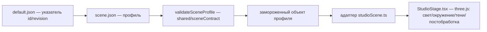

# Слой «Сцена» — свет, окружение, тени (черновик)

_Моя первичная версия для обсуждения. Источники: `docs/SCENE_DELIVERY.md`,
`app/shared/sceneContract.mjs`, `app/server/scenes.mjs`, `app/src/sceneLoader.ts`,
`app/src/StudioStage.tsx`. Связь: карта слоёв в [`README.md`](README.md)._

## Зачем нужна
Сцена — это **павильон / студия**: условия съёмки, в которых стоит продукт. Свет,
окружение для отражений, фон, экспозиция, тени, AO. Она отвечает за то, «как
снято», и **ничего не знает о том, какой продукт снимается**. Один и тот же
продукт в разных сценах выглядит по-разному; одна сцена обслуживает любой продукт.

## Что делает (возможности)
Через JSON-профиль доставляются и применяются:
- **Свет**: key, fill, ambient, hemisphere — позиции, цели, цвет, интенсивность.
- **Окружение/отражения**: фон (верх/низ градиента), карта окружения, 1–12
  софтбоксов (в принятой студии — 4). Внешний HDR не поддержан (загрузчик не добавлен).
- **Фон/пол, экспозиция, длительность появления**: CSS-подложка считается из тех же
  параметров с тем же ACES, что и 3D-фон (визуальная непрерывность).
- **Тени** (площадная/контактная): радиус, контактная доля, плотность,
  непрозрачность, цвет, приёмник, число кадров/источников, разрешения карт.
- **Карты теней** (bias/normalBias) и **GTAO** (интенсивность/радиус/толщина/пробы).

> **Граница со слоем «Тень» (решение владельца, 8 ноя 2026).** Свет сцены задаёт тени
> **направление** (`key.position`) и **чёткость** (размер источника `shadow.radius`, размер
> карты `shadow.lightMapSize`). **Как тень выглядит** (пол и объект) — отдельный пакет тени,
> который выбирает объект. Подробно — [`shadow.md`](shadow.md).

## Как резолвится
Цепочка (одинаково на клиенте и на сервере):

- Клиент (`loadScene`): `GET /api/scenes/default` (сервер сам читает указатель и
  отдаёт полный профиль) либо `GET /api/scenes/<id>/<revision>`. Проверяет
  `X-Scene-SHA256` против локально посчитанного sha, валидирует, сверяет identity,
  замораживает. Опционально сверяется ожидаемый sha (parity c PNG).
- Сервер (`readScene`): читает `app/config/scenes/<id>/<revision>/scene.json` на каждый
  запрос (без пересборки/перезапуска), лимит 64 КиБ, валидирует, считает sha.
  Коды: `409` — sha не совпал, `404` — нет ревизии, `503` — повреждено/битый JSON.
  Указатель `default.json` ≤ 512 байт. Ответ не раскрывает путь/содержимое ошибки.

## Допуск: кто «заходит» в сцену, кто нет
Пропускается только то, что проходит `validateSceneProfile`:
- `schemaVersion: 1`, `engine: source-studio-v01` — иначе отказ целиком.
- **Координатный договор заморожен**: метры, `worldScale: 12`, Y-вверх, фронт +Z,
  пол Y=0, приёмник тени Y=0.002. Любое отклонение — ошибка, не «тихий сдвиг».
- `toneMapping: aces-filmic`, `shadowType: basic` — зашиты.
- `id`/`revision` — по regex, без путей, URL и выражений; неизвестные поля
  отклоняются целиком; 1–12 софтбоксов; все числа в заданных диапазонах.

Не пропускается: произвольный рендерер/программа, GLSL, свои алгоритмы, внешний
HDR; а также данные геометрии/скина/камеры/композиции — **сцена от них не зависит**.
Новый «look»/тип сцены — это **новая версия движка + адаптер + проверки**, а не
произвольный JSON.

## Принципы
- **Независимая доставка.** Сцена приезжает отдельным JSON/API, независимо от GLB,
  скинов, каталога камер и JS-сборки.
- **Данные выбирают поддержанное, а не задают рендерер.** JSON — это выбор
  параметров в рамках версии движка.
- **Тени не картинкой.** Считаются по геометрии/позе/свету/приёмнику; поворот,
  снятие крышки, low↔final, смена сцены — всё пересчитывается.
- **Parity client↔PNG по fingerprint.** sha профиля сверяется с обеих сторон.
- **Горячая замена, без polling.** Node читает файл на запрос; переключение
  указателя/добавление ревизии не требует сборки; в открытой странице профиль
  сам не меняется.

## Ограничения (сознательные)
64 КиБ профиль / 512 Б указатель; движок залочен (`source-studio-v01`); ACES/sRGB/
BasicShadowMap фиксированы в коде; геометрия циклорамы, диапазон shadow-камеры,
denoise — код версии; высота приёмника тени пришпилена.

## Моя оценка и что стоит менять
- **Хорошо**: сцена уже продукт-агностична — ровно то, чего ты хочешь («сцена под
  один продукт, состав добавляется отдельно»). Менять саму модель не нужно.
- **Протечка композиции в сцену**: в тенях есть `shadow.compositionScale` — это
  знание про «несколько продуктов», которого в сцене быть не должно. Кандидат на
  вынос в слой «Композиция».
- **Связь с принципом «тело ≠ ссылка»**: сегодня профиль = файл в `app/config/scenes`
  (локатор), идентичность = `id+revision+sha256`. При переезде в сторейдж меняется
  только локатор; контракт не трогаем.
- **Пробел возможностей**: нет внешнего HDR-окружения — ограничивает богатые
  отражения; решить, нужен ли как новая версия движка.

## Открытые вопросы к обсуждению
Выносить ли `compositionScale` из сцены в композицию. Нужен ли HDR-энв. Должна ли
сцена иметь «слоты» под N продуктов или оставаться павильоном, а состав целиком
отдать композиции (моя рекомендация — второе).
