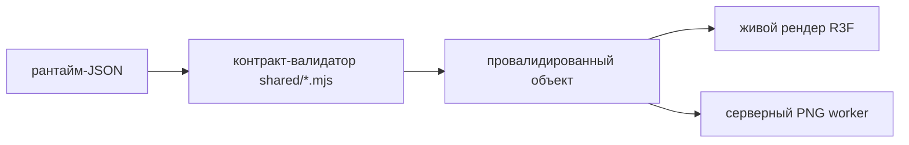
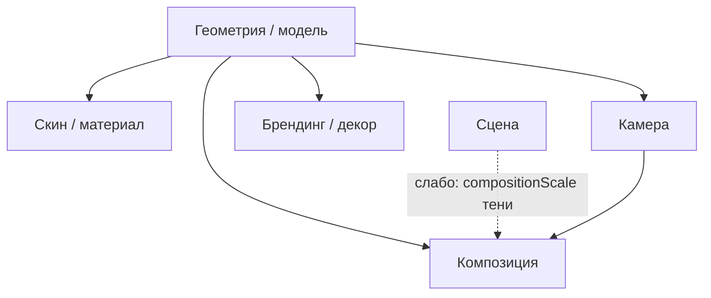

# Архитектура S. 3DLABS — точка входа

Назначение: единый источник правды по архитектуре приложения. Ведём итеративно,
разбирая по одному термину. Источник правды — этот каталог в репозитории
(`docs/architecture/`); обзор в Claude-проекте ссылается сюда. Пока сознательно
фокусируемся на **одном продукте — бутылке** — и доводим её до эталонной
реализации; остальные товары переносим в ту же модель позже.

## Регламент работы над архитектурой
- **В git напрямую не коммитим.** Когда работаем над архитектурой, все изменения
  делаются только локально; владелец сам их просматривает и сам коммитит.
- **Один слой — один поддокумент** `0X-*.md`. В этом README держим краткое
  описание сущности и **ссылку** на поддокумент; подробности переезжают внутрь
  поддокумента, README со временем сокращаем.

## Инструменты документации
- **Схемы — Mermaid.** Диаграммы рисуем прямо в Markdown ```mermaid```-блоками
  (рендерятся на GitHub и в превью; в проекте стоит `mmdc` для экспорта в PNG/SVG).
  Пример:



- **Интерфейсы — TypeScript.** Описание слоёв/контрактов ведём в TS-синтаксисе.
  Это уже идиома проекта: рядом с каждым контрактом в `shared/` лежит `.d.mts`
  (`renderContract.d.mts`, `sceneContract.d.mts`, `skinContract.d.mts`, …) — это
  канонические реализованные типы. Человеко-читаемая карта интерфейсов —
  [`interfaces.md`](interfaces.md), она ссылается на эти `.d.mts` как на источник.

## Как читать
Каждый слой кадра описан единообразно: **Зона ответственности** (за что отвечает
и за что НЕ отвечает) · **Данные и единицы** (что входит в сущность, в каких
единицах) · **Как сейчас** (что реально в коде для бутылки) · **Открытые
вопросы** (что решаем вместе — здесь фиксируем позиции владельца и спорные места).

## Сквозные принципы (кросс-слойные)
Действуют поверх всех слоёв. Договариваемся о них отдельно, потому что они меняют
форму каждого контракта.

**П1. Тело ≠ ссылка. Хранилище абстрагировано.**
Файлы в репозитории — временная форма. Контракт оперирует **идентичностью**
(`id` + `revision` + `sha256`) и **локатором** (где физически лежит тело). Сегодня
локатор = путь в репо, завтра = ключ объекта в сторейдже у провайдера. Правило:
идентичность и целостность неизменны и входят в fingerprint; локатор подменяем и в
fingerprint не входит. Это даёт переезд в БД/сторейдж без смены контракта.
_(В текущем коде это наполовину есть: `sha256` = идентичность/целостность, `file`
= локатор. Нужно формально развести.)_

**П2. Единица измерения — часть контракта и механизм защиты.**
Каждое числовое поле несёт явную единицу (метры / мм / градусы / радианы /
нормализованные 0..1 / linear-цвет). Координатный договор заморожен (метры,
worldScale, Y-up, front +Z, groundY). Защита: несовпадение единиц или системы
координат обязано валить валидацию, а не «тихо смещать» объект. Открытый вопрос —
идея владельца: зашить единицу/систему в fingerprint так, чтобы подмена единицы
меняла sha и ломала parity клиент↔PNG. Проработаем в разделе про единицы.

**П3. Сущность собирается в один лист.**
Для каждого слоя — одна «карточка сущности»: что входит, где лежит, в каких
единицах, кто владелец, что с чем связано по ключам. Чтобы не было «схема тут,
картинки там, манифест в третьем месте».

**П4. Разделяем то, что сейчас слито:**
— **сцена ≠ состав кадра** (павильон отдельно, кто в нём стоит — отдельно);
— **параметрический вид ≠ исполнительная камера** (человекочитаемый ракурс
отдельно, матрица для рендерера отдельно);
— **контракт ≠ исполнитель** (один контракт, несколько рендереров-исполнителей:
живая сцена, PNG-провайдер).

## Карта слоёв (зависимости)
Черновик — собран, чтобы видеть связи; будем править. Стрелка «A → B» = «B зависит
от A». Начинаем с наименее связанного слоя (**Сцена**), худший старт — **Композиция**.



## Термины (слои кадра)

### 1. Модель / геометрия (LOD)
**Зона ответственности.** Форма, топология, UV-развёртка, пивоты, слоты
материалов (`materialSlotId`), состояния формы (closed/open/lying), уровни
детализации low → final. НЕ отвечает за цвет, материал, свет, камеру.
**Данные и единицы.** Геометрический GLB (только меши + UV + slot-id, без
материалов) + манифест (трисы, sha, мастер-.blend). Единицы: метры, Y-up, front +Z.
**Как сейчас.** Для бутылки геометрия физически отделена от материала
(`bottle-geometry-low/final-v01.glb`), состояния выводятся рантаймом из одного
хранимого `closed`.
**Открытые вопросы.** Зафиксировать правило вывода состояний; формально описать
«слот» как точку стыковки геометрия↔скин.

### 2. Скин / материал
**Зона ответственности.** PBR-материалы и их привязка к слотам геометрии,
текстуры, профили low/final. НЕ несёт геометрию и UV (только ссылается на них по
compatibility-ключам).
**Данные и единицы.** `skin.json` (массив материалов: baseColor linear 0..1,
metalness/roughness 0..1, KHR-расширения, texture_transform) + набор карт
(content-addressed PNG). Привязка — `uvLayout` / `materialBindings` /
`materialSlotId`.
**Как сейчас.** 9 скинов бутылки, двойной профиль low/final, текстуры по sha. Но
«сущность скина» размазана: материалы в одном файле, карты в `public/textures`,
реестр в `shared`.
**Открытые вопросы.** Собрать карточку сущности скина: материалы + перечень карт +
их назначение + какая карта в какой слот. Первый приоритет — отдельный файл
`02-skin-material.md`.

### 3. Камера
**Зона ответственности.** Взгляд на продукт. Разделяем надвое: **параметрический
вид** (azimuth/elevation/fov/roll/subject/margin/focus — человекочитаемо,
редактируемо) и **исполнительная камера** (позиция + quaternion +
projectionMatrix — точная репродукция для рендерера).
**Данные и единицы.** Углы — градусы; дистанции/near/far — метры; focus — мм;
матрицы — безразмерные. Виды хранятся per-state.
**Как сейчас.** Контракт камеры валидирует и параметрику, и полную матрицу;
серверный PNG воспроизводит ровно клиентскую камеру (отсюда пиксельная
идентичность). Виды — чистые данные, без исполняемых колбэков.
**Открытые вопросы (ключевые).** Публичная API: «засетить камеру» в исполнителя.
Описать: интерфейс камеры на вход, кто исполнитель (живая сцена / внешний
PNG-провайдер), жизненный цикл эфемерного инстанса (принял камеру+объект → отдал
PNG → освободился). Выносим в `03-camera.md` + раздел про рендерер.

### 4. Сцена
**Зона ответственности.** «Павильон»: свет (key/fill/hemisphere/ambient),
окружение (softbox-боксы), фон, экспозиция/тонмаппинг, тени, AO, координатный
договор. НЕ отвечает за то, какие продукты в кадре.
**Данные и единицы.** Профиль сцены (exposure 0.1..4, цвета #hex, интенсивности,
позиции в метрах, разрешения теней/окружения). Движок залочен
(`source-studio-v01`).
**Как сейчас.** Сцена уже продукт-агностична — это правильно. Проблема рядом:
контракт композиции завязан на продукты.
**Позиция владельца.** Сцена заточена под один продукт по умолчанию, но умеет
динамически принимать другие — и состав не «зашит» заранее. Возможен вариант
«перегрузки» сцены в сцену, поддерживающую N продуктов. Решаем: сцена описывает
только павильон; «кто стоит» — слой композиции (п.5).
**Открытые вопросы.** Нужны ли сцене сведения о числе продуктов вообще (сейчас
есть `compositionScale` у тени) — или это полностью уходит в композицию. Подробно — [`04-scene.md`](04-scene.md).

### 5. Композиция
**Зона ответственности.** Состав кадра и размещение: какие элементы, где
(трансформы), кто primary, что видимо.
**Данные и единицы.** Элементы (до N) с position/rotation/scale, root-трансформ,
ссылка primary. Единицы позиций уточним (нормализованные/метровые).
**Как сейчас.** Контракт допускает до 8 элементов, но валидатор принимает только
`product === 'bottle'` (адаптеры под другие продукты не готовы) — то есть «8
продуктов» это не «вшито 8 штук», а верхний лимит мест; реализован один адаптер.
**Позиция владельца.** Композиция — это математическая формула «что есть и куда
можно поставить», динамическая, не привязанная к фиксированному набору продуктов.
Продукты подключаются адаптерами по требованию, а не существуют в сцене постоянно.
**Открытые вопросы.** Описать композицию как чистую геометрию слотов размещения
(формула) отдельно от продуктовых адаптеров. Выносим в `05-composition.md`.

### 6. Брендинг / декор (логотип)
**Зона ответственности.** Нанесение логотипа: зоны (body/lid), техники
(laser/pad/screen/…), лимиты цветов, сам логотип.
**Данные и единицы.** Зоны из спеки (ширина/высота в мм, center нормализован
0..1, азимут в градусах) + ссылка на логотип (`sample`/`none`/`uploaded` с sha +
размеры в px, лимиты 2048px/17MB).
**Как сейчас.** Полный контракт для бутылки; `patchDecoration` откатывает на
совместимую технику при смене зоны.
**Открытые вопросы.** Единая карточка «что может быть нанесено и куда» для бутылки.

## Исполнение (рендерер) — не слой, а исполнитель
Рендерер принимает собранный контракт (камера + скин + сцена + композиция + декор)
и выдаёт пиксели. Исполнителей несколько, контракт один: **живой рендер в
браузере** и **серверный/внешний PNG**. Модель владельца: инстанс-исполнитель
эфемерен — получил камеру и объект, сделал снимок, вернул, освободился. Отдельный
разбор вместе с публичной API камеры (п.3).

## Пока откладываем
**Selectel / деплой** — инфраструктурный слой, к сути контрактов не относится;
вернёмся позже отдельно.

## Статус и порядок работы
Черновик точки входа. Дальше по пунктам, по приоритету: сначала **сущность скина
(п.2)**, затем **камера + публичная API (п.3)**, затем **сцена/композиция
(п.4–5)**. Каждый пункт разворачиваем в отдельный файл `0X-*.md` рядом с этим.

## Поддокументы
- [`overview.md`](overview.md) — обзор проекта (держим синхронно с этим README).
- [`project-anatomy.md`](project-anatomy.md) — из чего состоит проект: сборка,
  пакеты, зависимости, модули, деплой/Docker.
- [`interfaces.md`](interfaces.md) — карта TypeScript-интерфейсов (→ `shared/*.d.mts`).
- [`04-scene.md`](04-scene.md) — слой «Сцена» (первый разобранный слой).
- `_review-notes.md` — рабочие заметки/комментарии владельца (до синтеза).
