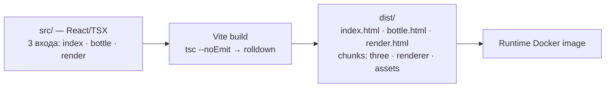
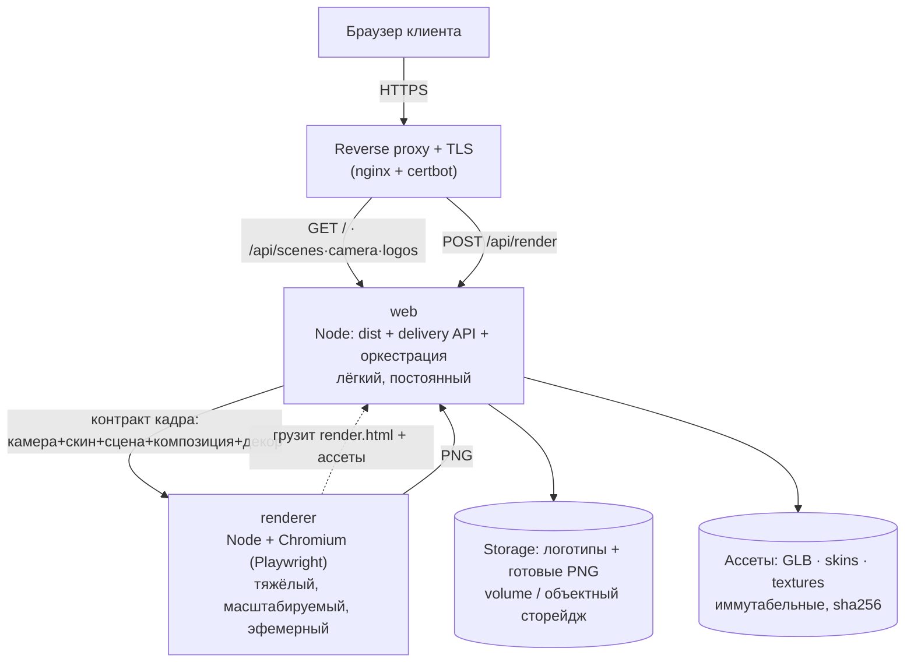

# Среда и топология: что где работает (черновик)

_Цель — собрать «кучу накиданного» в стандартную картину: что собирается, что
крутится, на каких машинах и как связано; и раздать зоны ответственности.
Направление согласовано: School B (код в подпапку, devops сверху), рендер — два
сервиса (web + renderer)._

## Стек одним абзацем (что такое Vite и зачем)
**Vite** — это две вещи: (1) дев-сервер с мгновенной горячей заменой модулей (HMR)
на время разработки и (2) бандлер прод-сборки (внутри — rolldown). Он берёт
исходники из `app/src/` и собирает статические файлы в `app/dist/`. Он **не рантайм**: в
проде Vite не работает, работает только то, что он собрал. TypeScript здесь —
гейт: `npm run build` = `tsc --noEmit` (проверка типов) → `vite build`.

«Три точки входа» — это не три приложения на трёх машинах, а **три страницы из
одной кодовой базы**, собираемые Vite разом (`rolldownOptions.input`):
`index.html` (студия SOURCE), `bottle.html` (страница бутылки + публичный API),
`render.html` (невидимый worker, который умеет нарисовать кадр и отдать PNG).
Тяжёлый 3D-код (`three`, `@react-three/*`) вынесен в отдельные чанки, чтобы
кэшироваться независимо.

Рядом — **свой Node-сервер** (`app/server/`, без фреймворка). Он не часть Vite: он
раздаёт собранный `app/dist`, отдаёт delivery-API и управляет рендером PNG.

## Build-time vs runtime
Это первая линия сегментации: что происходит один раз при сборке, а что живёт в
проде.



## Прод-топология (цель: два сервиса)
Сегодня web и renderer — **один процесс**: `POST /api/render` прямо в нём поднимает
Chromium, который заходит на тот же origin за `render.html` + ассетами, рисует кадр
в браузере, возвращает base64-PNG, а сервер сверяет, что камера/скин/сцена/
композиция/декор в результате совпали с запросом. Целевое — развести на два
контейнера за обратным прокси:



**Границы ответственности при разделении.** web остаётся оркестратором: валидирует
запрос, резолвит сцену (`app/config/scenes`) и логотип, зовёт renderer, отдаёт заголовки
fingerprint. renderer становится чистым «**контракт-объект → PNG**»: пул эфемерных
воркеров (твоя модель «принял камеру+объект → PNG → освободил инстанс»).

**Ключевое решение к ревью (из кода):** сейчас Chromium рендерера грузит
`render.html` и ассеты по общему `origin`. При разделении есть два пути:
(а) renderer ходит за страницей/ассетами в `web` по сети (origin = адрес web; нужно
расширить same-origin allowlist); (б) renderer несёт собственную копию `app/dist`
(самодостаточен, но дублирование). Это определяет, что кладём в образ renderer.

## Dev vs prod
- **Dev**: `npm run dev` (Vite HMR, только фронт) или `npm run dev:bottle`
  (Node-сервер + Vite в middleware-режиме, с рендером). Один процесс, bind-mount
  исходников.
- **Prod**: собранный `app/dist` внутри образа, `node server/start.mjs --production`;
  Vite не участвует. Планируем два образа/сервиса (web, renderer).

## Сегментация: зоны ответственности
Чтобы можно было «взяться за участок», каждый юнит с явной ответственностью и
границей вход/выход:

- **Build-оснастка (Vite + TS)** — `app/src/` → `app/dist/`. Только при сборке, в проде нет.
- **Сервис `web` (Node)** — раздаёт `app/dist`, delivery-API (`/api/scenes`,
  `/api/camera-views`, `/api/logos`), оркестрирует `/api/render` (валидация, резолв
  сцены/логотипа, вызов renderer, заголовки fingerprint). Владеет мутабельным
  состоянием через storage.
- **Сервис `renderer` (Node + Chromium)** — только «контракт кадра → PNG»; пул
  эфемерных воркеров; грузит `render.html` + ассеты; сверяет parity результата.
- **Контракты `app/shared/*.mjs` (+ `.d.mts`)** — единый источник правды валидации и
  типов для клиента и обоих сервисов. Ни от чего не зависят.
- **Runtime-конфиг `app/config/`** — указатель+профили сцен, каталог камер; горячая
  доставка без пересборки.
- **Ассеты `app/models/` + `app/public/`** — геометрия, скины, текстуры; иммутабельные
  (sha256), кэшируемы, могут жить в CDN/сторейдже.
- **Storage** — мутабельное: загруженные логотипы, готовые PNG (volume / объектный
  сторейдж; «тело ≠ ссылка»).
- **Proxy + TLS** — вход, маршрутизация web↔renderer, сертификаты.
- **DevOps-оснастка (`ops/`)** — сборка, запуск, эксплуатация, `bin/`-пульт.

## Целевая раскладка репозитория (School B)
```
repo/
├─ ops/                 # DevOps сверху
│  ├─ bin/              # up · build · sh · logs · test
│  ├─ docker/           # Dockerfile(web) · Dockerfile(renderer) · compose · ignore
│  └─ <target>/         # selectel: systemd/nginx/certbot — тонкий оверлей
├─ app/                 # приложение целиком (переезд из корня)
│  ├─ src/ server/ shared/ config/ models/ public/
│  └─ package.json · vite.config.ts · tsconfig.json
└─ README · docs/
```
Переезд `app/` — большой разовый шаг (пути в `vite.config.ts`, резолв корня в
`app/server/start.mjs`, `tsconfig`, скрипты, тесты, доки). Делаем осознанно и один раз,
отдельным согласованным планом миграции.

## Решения к ревью
1. Путь ассетов для renderer: (а) по сети из web или (б) своя копия `app/dist`.
2. Имя подпапки приложения: `app/` или `app/src/` (как в Mageworx).
3. Порядок: сначала `ops/` + `bin/` + два Dockerfile (код на месте), потом переезд
   в `app/` — или переезжаем сразу.
