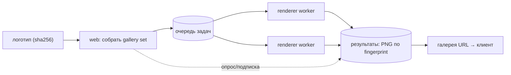

# Рендер как асинхронная галерея (черновик)

_Назначение серверного рендера переопределено владельцем: не онлайн-рендер по
запросу, а асинхронная доставка пред-рендеренной галереи. Прямой онлайн-рендер
делать не хотим — дорого, неконтролируемо, всё равно упирается в очереди._

## Зачем (продуктовая причина)
Живой 3D-плеер требует способного устройства и нормальной сети. Для слабых клиентов
(детектируем возможности/скорость) вместо 3D-плеера доставляем **галерею
пред-рендеренных изображений** объекта.

## Почему асинхронно
Задача ставится в очередь, воркеры (Chromium) считают, результат складывается,
клиент подписывается и забирает готовое. Плюсы: контроль стоимости (ограниченный
пул), кэшируемость, батчинг, устойчивость (ретраи), развязка от латентности запроса.

## Поток
1. Триггер: загружен логотип → запрос на галерею объекта.
2. `web` определяет **gallery set** — набор {scene × camera × state × skin} для объекта.
3. `web` ставит батч-задачу в очередь (с общим логотипом).
4. Воркеры `renderer` берут задачи, рендерят (тёплый браузер/сцена переиспользуются).
5. Результаты складываются в хранилище, ключ = общий **fingerprint**.
6. Клиент подписан (poll/SSE) → получает галерею (список PNG-URL) по готовности.

## Кэш по fingerprint (почему это естественно тут)
В проекте уже считаются sha камеры/сцены/скина/композиции/декора, а логотипы
content-addressed. Значит «тот же логотип + те же параметры» = тот же fingerprint =
готовый результат без повторного рендера. Галерея объекта детерминирована и
кэшируема по построению.

## Gallery set = часть пресета объекта
Какие сцены/камеры/состояния/скины входят в галерею — это пресет конкретного
объекта. Ложится на принцип «объект = внешний самодостаточный пакет с пресетами».

## Fallback на клиенте
Детект возможностей/сети → способный клиент получает живой плеер; слабый — галерею.
Доставка либо прямая (если готово в кэше), либо асинхронная (ждём готовности).

## Развилки (к ревью)
Очередь (in-process → Redis/BullMQ → cloud); хранилище (volume → объектный сторейдж);
транспорт подписки (poll → SSE/webhook); инвалидация кэша по ревизиям контрактов.
