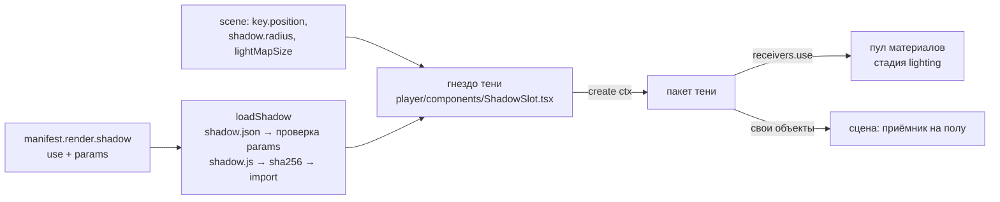

# Тень — отдельная сущность, которую выбирает объект

_Статус: **реализовано в плеере, на ревью** (8 ноя 2026). Связано: [`02-skin.md`](02-skin.md) §6 (пул обработчиков материалов), [`04-scene.md`](04-scene.md) (свет), issue #1._

## Решение владельца

- Тень **не часть движка**. Движок говорит: «для показа нужна тень — вставьте сюда пакет тени». Это **гнездо тени**.
- Тени лежат отдельно, набором: `shadows/<id>/<rev>/`. У каждой тени — номер, версия и контракт.
- **Объект** решает, какой тенью он пользуется и с какими параметрами. Без объявления тени объект не показывается.
- Подстроить тень объект может параметрами (в границах контракта тени) или выбрать другую тень (в том числе со своим кодом).

## Граница «свет сцены ↔ тень» (зафиксировано)

| Кто | За что отвечает | Где в данных |
|---|---|---|
| **Сцена (свет)** | **направление** тени — откуда светит ключевой свет | `scene.settings.key.position` |
| **Сцена (свет)** | **чёткость** тени — размер источника света (больше — мягче край) | `scene.settings.shadow.radius` |
| **Сцена (свет)** | **чёткость** тени — размер карты теней (больше — чётче) | `scene.settings.shadow.lightMapSize` |
| **Тень (пакет)** | **как тень выглядит на полу**: приёмник, плотность, цвет, контактное затемнение, накопление | `manifest.render.shadow.params` |
| **Тень (пакет)** | **как тень выглядит на объекте**: фильтр теней в материалах (только через пул, стадия `lighting`) | код пакета |

Правило: **тень не двигает и не меняет свет**, сцена не знает, какая тень вставлена. Тень получает от сцены ровно три значения (`SceneShadowLight`) и больше ничего.

> Переходный период. Поля `radius` и `lightMapSize` физически лежат в `scene.settings.shadow` вместе с полями вида тени (`opacity`, `color`, `contact`, `frames`, …) — так их читает старая студия. Плеер берёт из сцены **только** свет (три значения выше), а вид тени — **только** из пакета тени и `render.shadow.params`. При переводе студии на гнездо тени: поля вида тени из сцены удалить, поля света перенести в `scene.settings.key` (напр. `key.size`, `key.shadowMapSize`).

## Как объект выбирает тень

`objects/<id>/<rev>/manifest.json`:
```json
"render": {
  "scene": "scene/source-studio/v02/scene.json",
  "shadow": { "use": "soft-pcss@v01", "params": { "opacity": 0.48, "contact": 0.22, "position": [1, 0.002, 0] } }
}
```
- `use` — ключ тени `<id>@<rev>`, точная версия (повторяемость PNG и кэш по fingerprint).
- `params` — только то, что тень разрешила в своём контракте; не указанное — по умолчанию.
- `"shadow": null` — объект **явно** без тени. Отсутствие поля — ошибка.

## Пакет тени

```
shadows/<id>/<rev>/
  shadow.json   — контракт: id, revision, apiVersion, entry {file, sha256, bytes}, params {…}
  shadow.js     — код тени (ES-модуль, export default), проверяется по sha256 до исполнения
```

Параметр в `shadow.json`: `{ "type": "number"|"integer", "min", "max", "default" }`, `{ "type": "color", "default" }`, `{ "type": "vector3", "min", "max", "default" }`.

## Контракт кода (TypeScript, `app/src/player/sockets/shadowSocket.ts`)

Контракт данных (JSON) — `app/contracts/shadow.schema.json`, `shadow-declaration.schema.json`, типы `app/contracts/shadow.ts`; цепочка подключения — [`contracts.md`](contracts.md).

```ts
interface ShadowModule {                 // export default в shadow.js
  apiVersion: 1
  create(ctx: ShadowContext): ShadowInstance
}
interface ShadowContext {                // что даёт движок
  three: typeof THREE                    // единый three движка; свой импорт запрещён
  renderer: WebGLRenderer
  scene: Scene
  subject: Object3D                      // объект — отбрасывает тень
  light: SceneShadowLight                // от СЦЕНЫ: направление и чёткость
  params: Record<string, unknown>        // проверены по shadow.json, дополнены значениями по умолчанию
  receivers: { use(processor) }          // материалы объекта — только через пул, стадия 'lighting'
}
interface SceneShadowLight { position: [x, y, z]; radius: number; mapSize: number }
interface ShadowInstance {               // что возвращает тень
  reset(): void                          // начать накопление заново
  update(frame: { camera }): boolean     // шаг на кадр; true — нужен ещё кадр
  dispose(): void                        // убрать всё, что тень добавила в сцену
}
```

Что тени можно: добавлять в сцену **свои** объекты (приёмник, служебные лучи) и снимать их в `dispose`; подключать процессоры к материалам объекта через `receivers.use`. Нельзя: менять свет сцены, камеру, геометрию и материалы объекта в обход пула. Случайность — только детерминированная (один кадр → одна тень).

## Как движок вставляет тень



Ошибки — строго: нет объявления, нет пакета, параметр вне контракта, sha не сошлась, у сцены нет ключевого света, `create` упал — объект не показывается (состояние плеера `error`).

## Первая тень: `soft-pcss@v01`

Перенесена из движка без изменения вида: накопительная мягкая тень на полу (то, что раньше рисовал `AccumulativeShadows` в плеере) + PCSS-фильтр на материалах объекта. Отличие одно: вместо `Math.random` — детерминированный генератор.

## Что ещё не переведено

- **Старая студия и примеры** (`example1.html`, `bottle.html`, PNG-воркер) остаются как есть, со своим кодом теней (`bottleShadows.ts`, `StudioStage.tsx`). Работаем только с новым плеером `app/src/player/` (решение владельца, 8 ноя 2026).
- Тот же подход («гнездо + пакеты по выбору объекта») — кандидат для переходов качества (LOD) и методов брендинга.
